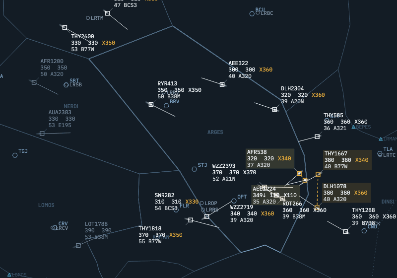
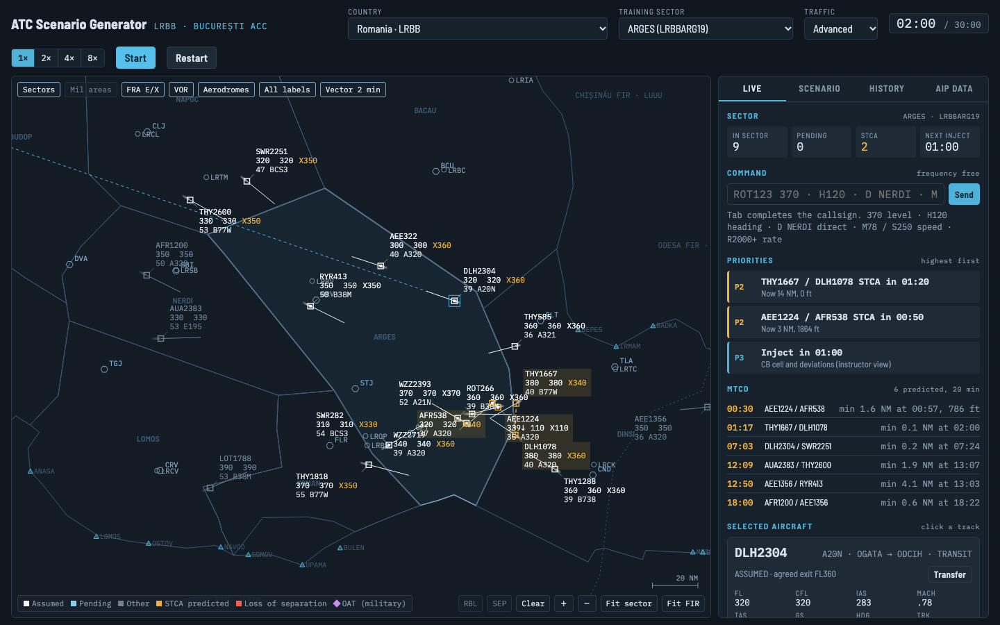

# ATC Scenario Generator

[](https://github.com/soitirakis/atc-scenario-generator/actions/workflows/ci.yml)
[](docs/TEST-STRATEGY.md#coverage-gate)
[](LICENSE)

**Live demo: https://soitirakis.github.io/atc-scenario-generator/** (runs in the browser, no install)

En-route radar training simulator that builds scenarios and injects for a chosen country, sector and traffic level, on top of real AIP data. Romania (Bucharest ACC, LRBB) is available from the country selector; more are added one module at a time. Hungary is withdrawn pending permission from HungaroControl (see [Data sources (Hungary)](#data-sources-hungary)).



- **Radar display** with the real sector polygons, VOR/DMEs, Free Route points and aerodromes.
- **Simulated traffic** flying Free Route directs between real entry and exit points, scaled by difficulty, with crossing conflicts deliberately built into the training sector.
- **Per-type aircraft performance** from OpenAP WRAP: climb and descent rates by level band, climb/cruise/descent CAS and Mach. TAS comes from IAS or Mach in the ISA atmosphere, and ground speed and track come from a per-scenario wind field, so a heading clearance drifts with the wind.
- **Speed and rate clearances**: IAS, Mach, resume normal speed, and "climb/descend at N ft/min or greater / or less".
- **STCA** at 5 NM / 1000 ft with a 3-minute look-ahead, plus **APW**, **CLAM**, **RAM** and an **MTCD** list (see below).
- **Injects that execute** in the simulation, shown in a priorities panel:
  - level bust
  - weather cell with deviation requests
  - radio failure (7600)
  - emergency descent (7700)
  - military area activation: a real TRA layer from eAIP ENR 5.2 over the sector
  - uncoordinated traffic
  - level requests
  - exit level coordination requests from the next sector
  - late transfers from the previous sector
  - a readback error (wrong level or heading read back)
  - similar callsigns on frequency, one taking the other's clearance
  - civil-military (training constructs): COMLOSS escalating to a QRA scramble, a non-RVSM OAT formation crossing, a short-notice military area extension
- **Clearances**: level, heading, direct-to, speed, and approve/unable on requests, from the panels or a **command line in controller shorthand** (see below).
- **Readbacks**: every clearance is read back by the pilot 2-6 s later and occupies the frequency; a clearance given while it is busy gets "say again".
- **Controller tools**: range-bearing lines, a SEP tool and a what-if level probe (see below).
- **Assume and transfer of control**: traffic about to enter the sector is transferred to you as pending and must be assumed; traffic leaving must be transferred before it crosses the boundary, cleared to its agreed exit level (XFL). Only aircraft on your frequency (pending or assumed) take clearances.
- **Debrief** at the end of the session, including late assumes, late transfers and wrong exit levels.
- **Repeatable sessions**: the same seed, sector and difficulty always give the same traffic.
- **Instructor and trainee windows**: an instructor window runs the session, with the inject timeline, a pseudo-pilot and live grading; a trainee window shows only what a controller would know (see below).

## Screenshots

**Romania, ARGES sector, advanced traffic.** STCA predicts a conflict (amber); the selected aircraft is assumed and cleared above its agreed exit level, so the panel flags the difference.



The image and the GIF above are generated by `npm run screenshots` (`scripts/screenshots.mjs`). It builds the app, opens it in Chromium with Playwright, and works the traffic with a scripted trainee. Sessions are seeded, so rerunning it reproduces the same images.

## Run it

```bash
npm install
npm run dev          # http://localhost:5173
npm run build        # one self-contained file: dist/index.html
```

`dist/index.html` has the code, styles and data inlined. Open it directly, host it anywhere, or publish it as a claude.ai artifact. The latest `main` is live at https://soitirakis.github.io/atc-scenario-generator/.

## Instructor and trainee windows

The app runs in one of three roles, chosen by the URL:

| URL | Role | What it shows |
|---|---|---|
| `/` | solo | Today's single-window practice mode: radar, priorities, inject list, everything. |
| `/?role=instructor` | instructor | Owns the simulation. Adds an **Instructor** tab: link status, live grading, the inject timeline (fire, hold, −1′/+1′, edit while the session runs) and a pseudo-pilot panel. Start / Freeze / Unfreeze and the speed buttons apply to both windows. |
| `/?role=trainee` | trainee | Radar, priorities, selected-aircraft panel and event log, as a controller would see them: no inject list, no "Inject in" warnings, no scenario title or challenges (the Scenario tab shows the briefing only), no instructor log lines, and no clock controls. Its clearances go to the instructor window. |

To start: in solo mode, open the **Scenario** tab and choose **Open instructor and trainee windows**, or open the two URLs yourself. Both windows must be in the same browser on the same computer: they talk over a [BroadcastChannel](https://developer.mozilla.org/docs/Web/API/BroadcastChannel). The instructor window sends a snapshot about once a second, and immediately after each trainee command. If the instructor window closes, the trainee window shows "Instructor window not responding" and keeps the last picture.

The **pseudo-pilot** speaks as the aircraft selected on the instructor's radar:
- make a request: climb or descend to a level, a weather deviation, or a direct to a point;
- refuse or query ("say again") the next clearance;
- deviate 20° left or right without a clearance;
- change squawk;
- go silent for two minutes and come back.

A silent pilot keeps their squawk, so nothing shows on the trainee's radar until a call goes unanswered. Only a 7600 squawk shows as a radio failure.

The sync layer is `src/link.js`. It decides what a trainee may see (`makeSnapshot`), and refuses any trainee command other than the controller actions (level, heading, direct, speed, own navigation, answer, assume, transfer, acknowledge emergency).

## Safety nets and monitoring aids

Each is a DOM-free module in `src/nets/` with its own unit tests. The simulator gives them predicted trajectories built with the same models as everything else (route or heading for position, `flAfter` for level). EUROCONTROL groups them differently, and the UI uses its names:

| | Type (EUROCONTROL) | What it does here | Settings |
|---|---|---|---|
| **STCA** | ground-based safety net | predicted or actual loss of 5 NM / 1000 ft within 3 minutes | `SEPARATION` in `sim.js` |
| **APW** | ground-based safety net | one of your aircraft inside an active military area (VIOLATION), or predicted to enter it within 2 minutes along its path and levels (PREDICTED) | `APW` in `nets/apw.js` |
| **CLAM** | monitoring aid | Mode S selected level differs from the cleared level (SFL), or the aircraft is more than 300 ft past or away from it (DEV). Level busts are detected here, from what the radar sees | `CLAM` in `nets/clam.js` |
| **RAM** | monitoring aid | more than 3 NM off the cleared route leg while not on a heading from ATC, for example a pilot deviating on their own | `RAM` in `nets/ram.js` |
| **MTCD** | planning tool | flights' planned paths compared 20 minutes ahead, every 10 s; predicted conflicts are listed on the Live tab (time to loss, closest point), not alerted. A pair is listed when one flight is yours or the conflict is in your sector | `MTCD` in `nets/mtcd.js` |

APW, CLAM and RAM alerts appear in the priorities list, for your traffic (assumed or pending).

**These are simplified training versions, not the operational systems:** there is no alert suppression (an alert stays up for as long as its condition holds), and no per-area tuning (one set of parameters for the whole FIR, with no adaptation by area, sector or flight phase).

## Civil-military injects

Training constructs (`data/<CODE>/military.json`, labelled in its `_note`), timings in `CIVMIL` in `src/sim.js`:

| Inject | What happens | Graded on |
|---|---|---|
| **COMLOSS and QRA scramble** | an aircraft goes silent with a normal squawk (no 7600). After 5 min the system declares COMLOSS and the priorities offer **Notify MIL**. 3 min after the notification a QRA pair takes off from the nearest configured base, climbs through civil traffic as OAT under military control to the silent aircraft, joins it; 3 min later contact is restored and the pair returns to base | military notified within 2 min of COMLOSS; the military's coordination call answered within 60 s; your traffic kept 5 NM / 2000 ft (1000 ft below FL290) from the QRA |
| **OAT formation (non-RVSM)** | the military pre-notify a formation of two crossing the sector at FL300-FL360 in about 3 min | coordination answered within 60 s; your traffic kept 5 NM / 2000 ft from it |
| **Short-notice extension** | the latest military area is extended 2000 ft down at 2 minutes' notice (with none active, one is activated at short notice) | none of your aircraft inside the new limits for 10 min |

**QRA bases.** Romania: **LRCK** (Mihail Kogălniceanu), F-16; position from the AIP aerodrome list. LRFT (Fetești) and LRCT (Câmpia Turzii) are left out for now: the civil eAIP does not publish them. That a base holds QRA, the aircraft, callsigns and timeline are invented for training.

**OAT tracks** are drawn as magenta diamonds (filled for a pair or formation) with their own label: callsign, `OAT x2`, level and `NRVSM`, and role (`QRA INTERCEPT`, `MIL`). They are under military control: not on your frequency, no clearances, never pending or assumed. Military fighters are treated as non-RVSM, so STCA, MTCD-style grading and the injects use 5 NM / 2000 ft from FL290 up (1000 ft below). Fighter performance (climb, descent, cruise and intercept speed) is in `military.json` as round training figures: OpenAP has no fighter models.

## Command line and readbacks

The **Command** box on the Live tab takes clearances in controller shorthand, one transmission per line:

| Type | Means |
|---|---|
| `ROT123 370` (or `FL370`) | climb or descend FL370 |
| `WZZ45 H120` | turn heading 120 |
| `THY1 D NERDI` (or `DNERDI`, `DCT NERDI`) | direct NERDI |
| `DLH3 M78` / `DLH3 S250` | Mach .78 / 250 kt IAS |
| `AFR12 R2000+` / `R1500-` | climb or descend at 2000 ft/min or greater / 1500 or less |
| `ROT123 370 H120` | several items in one transmission, read back together |

**Tab** completes the callsign when one matches, and the matches are listed as you type. The callsign must be complete before a clearance is sent: a partial one is never guessed, because guessing is how similar callsigns get confused. Errors (an unknown callsign, a level outside FL050-FL450, a heading of 400) are shown at once and nothing is sent. The parser is `src/cmdline.js`, pure and unit tested.

**Readbacks.** Every clearance, from the command line or the panels, is one transmission. The pilot reads it back in the log 2-6 s later (in italics), and the frequency is busy from the clearance until the readback ends: the box header says *frequency busy · CALLSIGN*. A clearance given then gets "say again" and is not applied. Clearances take effect when given; the readback is what you hear. Assume and transfer are system actions, not radio calls. Settings: `RADIO` in `src/sim.js`.

Two injects use this:
- **Readback error**: the next level or heading clearance to one of your aircraft is read back wrong (1000 ft or 30° off). The aircraft does what it read back 10 s after the readback, unless you correct it first; graded on whether you do. A wrong level shows as CLAM SFL once it is set.
- **Similar callsigns**: a flight with a similar callsign (WZZ4127 and WZZ4172) comes on frequency, and the next clearance to either is taken by the other one: it reads back with its own callsign and acts on it 10 s later unless you stop it.

## Controller tools

Pure modules in `src/tools/`, with unit tests. They work the same in the trainee window.

- **RBL** (chip on the radar): click a point or a track, then another. The line shows the bearing (degrees true) and range, and a track end follows the track. **Clear** removes all lines.
- **SEP**: click two tracks. It shows where each will be at their closest point, and the minimum distance and time, if both keep their present track and ground speed. Amber below 5 NM.
- **Probe level** (selected aircraft): pick a level in the Level list and press **Probe level**. It shows what clearing that level would do in the next 20 minutes, against every other flight's planned path, as MTCD predicts them. That covers each conflict (time to loss, minimum distance and when) and any military area, active or due, it would enter within that area's limits. Nothing is cleared. In the trainee window the probe runs in the instructor's simulation and the result comes back over the link.

## Scenario files and library

On the Scenario tab (solo or instructor window):
- **Export** saves the current scenario as JSON (`schemaVersion: 1`). The file holds the country, sector, traffic level, length, seed, objective, built-in conflicts, wind and injects, so it replays the same traffic. Each inject also carries its grading objective, for the reader; Import ignores it.
- **Import** checks the file first (`validateScenarioFile` in `src/scenario.js`) and lists every problem in plain words, for example a wrong schema version, an unknown country or sector, an unknown inject type, or an inject outside the session length. A valid file loads in both windows.
- **Sample scenarios** in `data/scenarios/` use the same format: ARGES foundational, DINSI with weather, a night shift on the collapsed KOMAN + LOMOS + NERDI sector (light traffic, an emergency and a military area), and NERDI coordination. Their objectives, criteria and inject notes are training material written for this project, not published procedures.

## Session history

Every session that runs to its end is saved as a **session record** in the solo or instructor window. The trainee window keeps none, because it has no simulator. Trainee and instructor names are optional and are asked on the start overlay.

A record (`schemaVersion: 1`, defined and checked in `src/records.js`) holds:
- the scenario file, which includes the seed, country and sector;
- the trainee and instructor names;
- the per-inject grading results;
- the timeline;
- the debrief statistics;
- the full clearance log: every transmission, assume, transfer and answer, with how it ended (`ok`, `blocked` on a busy frequency, `no reply`, `unable`, `say again`).

Records stay in the browser's IndexedDB (`src/store.js`): no login, no server, nothing leaves the computer unless you export it. On the **History** tab:
- **Open** shows the saved debrief, and **Replay** reloads the same scenario and seed.
- **Export** saves one record as JSON, and **Export all** saves every record in one file.
- **Import** reads either kind of file. Each record is checked on its own, and a record with an existing id replaces it.
- **Delete** takes two clicks.

If the browser gives the page no storage (a private window, blocked site data), the History tab says so. Records are then kept only until the page closes, and **Export record** in the debrief still works.

## Tests

```bash
npm test             # unit tests (Vitest): geometry, data integrity, simulation, scenarios, AIRAC parser
npm run test:coverage  # unit tests with coverage; fails below 85% on src/sim.js, src/scenario.js or any src/nets or src/tools module
npm run test:e2e     # end-to-end (Playwright) against the built file, desktop and phone viewports
```

What each layer covers, and why, is in [docs/TEST-STRATEGY.md](docs/TEST-STRATEGY.md).

CI runs the unit tests with coverage and the end-to-end tests on every push and pull request, and uploads the single-file build. On `main`, once both pass, it deploys that same file to GitHub Pages: https://soitirakis.github.io/atc-scenario-generator/

Dependabot (`.github/dependabot.yml`) checks weekly and opens one grouped pull request for npm packages and one for GitHub Actions; they merge like any other PR, after CI passes.

## Project layout

```
data/
  countries.js        registry of country modules
  RO/                 Romania: one JSON file per AIP source (see below)
src/
  geo.js              projection, AIP coordinate parsing, plane geometry, seeded RNG
  atmos.js            ISA atmosphere, CAS/TAS/Mach, wind field
  country.js          raw country module -> projected data
  sim.js              simulation engine (no DOM): traffic, physics, STCA, injects, clearances
  nets/               APW, CLAM, RAM, MTCD: pure modules, each with its settings (no DOM)
  tools/              range-bearing line, SEP, level probe: pure modules (no DOM)
  scenario.js         local scenario builder, Claude prompt and validator
  records.js          session records: builder, validator, import of one record or a bundle (no DOM)
  store.js            session records in IndexedDB, with a memory fallback when storage is unavailable
  render.js           canvas radar display
  link.js             instructor/trainee windows: BroadcastChannel protocol, trainee snapshot, read-only view
  main.js             UI wiring
  fonts/              bundled woff2 fonts (OFL) and their @font-face rules
scripts/
  airac-update.mjs    pull ENR 4.1 / 4.4 / 5.2 from the eAIP and diff against data/RO
  airac-lib.mjs       pure parsing helpers (unit tested), including the letter-code ENR 4.4.1 format and both ENR 5.2 formats
  openap-wrap.mjs     OpenAP WRAP -> data/performance.json (pinned commit)
  performance-lib.mjs WRAP table parser and unit conversion (unit tested)
  screenshots.mjs     regenerate docs/img/ (Playwright)
  coverage-badge.mjs  coverage summary -> shields.io badge JSON, published with the site
  test-counts.mjs     test counts in docs/TEST-STRATEGY.md from the test runners (CI checks them)
tests/
  unit/  e2e/  fixtures/
docs/
  TEST-STRATEGY.md    what each test layer covers and why
  img/                README screenshots and GIF
```

## Aircraft performance

`data/performance.json` is generated by `node scripts/openap-wrap.mjs` from **OpenAP WRAP** (Junzi Sun et al., TU Delft). It is pinned to OpenAP commit `46753acb` (2026-06-18) and covers every type in the traffic files. For each type it gives WRAP's typical value and range for:

- climb CAS, climb Mach and the crossover altitudes;
- mean climb rate below the CAS segment, at constant CAS and at constant Mach;
- cruise CAS, cruise Mach and maximum Mach;
- descent Mach and CAS, and the mean descent rates by phase.

The simulator flies the typical values. BADA is not used: it needs a EUROCONTROL licence.

| Our type | WRAP model | Why |
|---|---|---|
| A320, A321, A333, A388, B738, B77W, B788 | same type | WRAP has it |
| A20N, A359, E195 | a320, b789, e190 | OpenAP's synonym table |
| A21N | a321 | same airframe size; OpenAP's table maps it to a320 |
| B38M | b738 | same fuselage length; OpenAP's table maps it to b737 |
| BCS3 | e190 | not in OpenAP; nearest size class |

- **Speeds:** 250 kt below FL100, then the type's climb CAS up to its crossover, then climb Mach, cruise Mach in level flight, and descent Mach then CAS. An IAS or Mach clearance overrides the schedule, up to the type's maximum Mach.
- **Airspeed and wind:** TAS comes from IAS or Mach in the ISA atmosphere (`src/atmos.js`). The wind (direction it blows from, speed) is set per level and interpolated between levels. Each scenario gets a seeded default: westerly, strengthening to a 40–100 kt jet near FL340. You can edit it in the Scenario tab while the session runs.
- **Ground speed and track:** TAS along the heading plus the wind. In own navigation the aircraft corrects for drift and tracks to its next point; under a heading clearance it holds the heading and drifts.
- **STCA:** predicts along each aircraft's track at ground speed, and vertically with the banded rates, integrated second by second.

One value in OpenAP's own data is kept as published although it lies outside its range: for the A333, maximum cruise altitude has a typical value of 12.53 km against a maximum of 12.48 km. The simulator does not use it.

## Data sources (Romania)

| File | Content | Source |
|---|---|---|
| `sectors.json` | 10 elementary sectors (KOMAN as its two published layers: KOMAN 1 below FL245, KOMAN 2 FL245-FL660, which leaves out a strip along the Danube) + 5 collapsed (KOMAN = both layers) | EUROCONTROL NM RAD sector file `LR_Sector ID_14-08-25` |
| `borders.json` | border vertices between published sector corners | **approximated** from the national boundary |
| `navaids.json` | 16 VOR/DME | eAIP ENR 4.1 (AIRAC AMDT 11/26, page 3: 01/25) |
| `points.json` | 131 significant points with FRA role | eAIP ENR 4.4 (AIRAC AMDT 11/26) |
| `airports.json` | aerodrome reference points | eAIP AD 2 |
| `map.json` | Black Sea coastline and neighbour FIR labels for the radar background | **approximate**, not from an official source; display only |
| `military.json` | QRA base LRCK (F-16), OAT formation, fighter performance | **training construct**; LRCK position from AD 2 (`airports.json`); LRFT and LRCT not in the civil eAIP, left out |
| `areas.json` | 270 military areas (264 TRA, 6 TSA) with lateral and vertical limits | eAIP ENR 5.2 (edition 2026-10-29), parsed by `npm run airac`; three limits the AIP prints as `L200`/`L280` are kept as published and read as flight levels (an allow-list in `scripts/airac-lib.mjs`; any other unknown format stops the parse) |
| `traffic.json` | gates, flow weights, operators, main airports (LROP), agreed exit levels | modelling choice, not published data; exit levels are **modelled, not from a published Letter of Agreement** |
| `data/performance.json` (shared) | per-type climb/descent rates by level band, climb/cruise/descent Mach and speeds | converted from [OpenAP](https://github.com/TUDelft-CNS-ATM/openap) WRAP kinematic data (TU Delft, GPL-3.0) at commit [`46753acb`](https://github.com/TUDelft-CNS-ATM/openap/tree/46753acb988c1e8c9d47ec5ae72d6fb75b9cf260/openap/data/wrap) by `scripts/openap-wrap.mjs` |

eAIP: https://aisro.ro/aip/2026-10-29/html/ro/aip_toc_enr.html

**FRA point roles** in `points.json`:

| Role | Meaning |
|---|---|
| `E` / `X` / `EX` | Horizontal entry, exit, or both, at upper levels |
| `L` | Entry or exit only in a band topping out at FL175 or below |
| `I` | Intermediate point only |

**What is not real:**
- military area activity: the areas are published, but when one is active is the instructor's choice (the AIP says "by NOTAM"), and the simulator treats an active TRA as closed to your traffic, without transit by clearance;
- the flow weights;
- the border segments between published sector corners;
- the civil-military injects: which base holds QRA, the aircraft, callsigns, timeline and fighter performance (`military.json`);
- aircraft performance: WRAP values are statistical models fitted to ADS-B flight data, not manufacturer or BADA data. BADA was not used because it requires a EUROCONTROL licence.

As of 1 November 2026, the Ukrainian entry and exit points are kept in the data but carry no traffic (`closed: true`).

## Data sources (Hungary)

The Hungary module (Budapest ACC, LHCC) is withdrawn pending permission from HungaroControl. AIP Hungary GEN 0.1 §5 makes any use of the AIP, in full or in part, subject to HungaroControl's prior written consent. It comes back if HungaroControl gives that consent. Its data, sample scenarios, screenshot and data tests are removed, and the country selector lists it as pending. The engine features it used (sector layers, several source AIPs) and the parsers for its eAIP table formats stay; the parsers are tested on synthetic fixtures with invented names and coordinates.

## Updating for a new AIRAC cycle

AIRAC cycles change every 28 days. The eAIP has no data API, so updates are a scripted pull of the published pages, followed by a diff against `data/RO`. Nothing is written without `--write`.

```bash
npm run airac                                    # current cycle, report only
npm run airac -- --edition 2026-10-29            # a specific eAIP edition
npm run airac -- --write                         # apply, then run npm test and commit
```

- **Source:** the ROMATSA eAIP, as PDF: ENR 4.1, ENR 4.4 and ENR 5.2. There is a new edition every AIRAC cycle.
- **New points added by `--write`:** entry/exit points only (`E`, `X`, `EX`); the point set is curated.
- **`meta.json` on `--write`:** `airac.edition` and the edition in the eAIP source links. The AMDT labels in `enr41`/`enr44` are per page; check them by hand.
- `--country HU` stops with a message while Hungary is withdrawn; the script does not download HungaroControl's eAIP.

What the script does and doesn't do:
- **Updates** coordinates and roles of existing points, and frequency/position of VORs.
- **Rewrites** `areas.json` from ENR 5.2 on `--write`, after reporting areas that changed, were removed or are new.
- **Adds** new points with the roles shown above.
- **Reports** points that have been removed, or that lost their FRA role. It will not delete a point that `traffic.json` still uses (gates or main-airport connection points).
- **Does not** touch sector polygons or borders. Update `sectors.json` by hand when EUROCONTROL NM publishes a new LR sector file.

## Adding a country

1. Create `data/<CODE>/` with the same eight files as `data/RO/`. Coordinates stay in AIP notation (`DDMMSSN DDDMMSSE`); `{ "b": "KEY" }` inside a sector polygon splices in a border segment from `borders.json`, and `{ "b": "KEY", "upTo": "DMS" }` only the part before a published point on it. In `meta.json`, `defaultSector` picks the sector selected when the country loads, and `simNote` is the traffic note shown in the AIP data tab.

   **Sectors are volumes.** A sector with no limits is checked laterally only. Give `lower` and `upper` as published (`"FL 245"`, `"GND"`, `"Lower limit of ATS routes"`) to make it a layer. The lower limit is inclusive and the upper exclusive, so a level on a layer boundary belongs to the upper layer. Layers of one lateral sector share a `group`, the label drawn once on the map. The sector selection shows each layer with its band, e.g. "KOMAN 2 FL245-FL660":

   ```json
   { "id": "KOM2", "rad": "LRBBKOM19", "name": "KOMAN 2", "group": "KOMAN",
     "lower": "FL 245", "upper": "FL 660", "poly": ["445418N 0254515E", { "b": "KOMAN_BG", "upTo": "435213N 0255833E" }, "…"] }
   ```

   A collapsed configuration lists its `parts`: elementary sectors, layers or collapsed configurations listed before it (Romania's KNL is KOM + LOM + NER, and KOM is KOM1 + KOM2).

   **Delegated airspace.** A sector can take in an area delegated from a neighbouring unit (`include`) or give one up (`exclude`). Each area has its own band, and an aircraft is inside the sector when it is in the sector's own volume or an included area, and not in an excluded area at its level. The units and levels below only show the format; take real delegations from the AIP or the Letter of Agreement, and cite it in `note`:

   ```json
   "include": [{ "from": "Sofia ACC", "lower": "FL 245", "upper": "FL 660", "poly": ["…"], "note": "LoA reference" }],
   "exclude": [{ "to": "Beograd ACC", "lower": "FL 305", "upper": "FL 660", "poly": ["…"] }]
   ```

   **Several source AIPs.** A module covering airspace of several states (Maastricht UAC: Belgium, Netherlands, Luxembourg, Germany) lists each state's eAIP in `meta.json`; the AIP data tab shows one row and one link per state:

   ```json
   "aips": [
     { "state": "Netherlands", "url": "https://…", "edition": "2026-10-29", "amendment": "AIRAC AMDT 11/26" },
     { "state": "Belgium", "url": "https://…", "edition": "2026-10-29", "amendment": "AIRAC AMDT 11/26" }
   ]
   ```

   Without `aips`, the module's single eAIP is `airac.edition` with the first link in `sources`. `npm run airac` handles single-AIP modules only.
2. Choose real FRA entry/exit points as traffic gates and write the flow table. Each flow is `[from, to, weight]` between two gate groups, or between a gate group and a main airport. Flows are flown in both directions.
3. Optionally declare one or more main airports in `traffic.json` to get arrivals and departures:

   ```json
   "mainAirports": [
     {
       "icao": "LROP",
       "approach": "Bucharest APP",
       "handoffNM": 35,
       "arr": { "W": "PEMOK", "S": "SORDU" },
       "dep": { "W": "SOKRU", "S": "POLUN" }
     }
   ]
   ```

   - `icao` must also be in `airports.json`.
   - `arr` and `dep` map each gate group to the FRA point where arrivals leave the network and departures join it. Every gate group that has a flow to the airport needs both.
   - Arrivals are transferred to `approach` once they are within `handoffNM` of the airport.

   Leave `mainAirports` out for a transit-only country.

   **Upper airspace only.** A unit that controls no airports (an upper area control centre) sets `"upperOnly": { "lowerLimit": "FL 245", "lowerUnit": "Amsterdam ACC" }` in `meta.json`. Its main airports have no `approach`. Instead, `lowerUnit` names the unit below, the hand-off boundary (`handoffNM` from the airport) and the agreed levels. The numbers below only show the format: label real ones as modelled unless they come from a Letter of Agreement:

   ```json
   { "icao": "EHAM", "lowerUnit": { "name": "Amsterdam ACC", "handoffNM": 60, "arrFL": 250, "depFL": 260 }, "arr": { "…": "…" }, "dep": { "…": "…" } }
   ```

   - **Arrivals** have `arrFL` as their agreed exit level and ask to descend to it. They are handed to the lower unit at the boundary; one more than 500 ft above `arrFL` there is logged as too high.
   - **Departures** appear at the boundary 1000 ft below the unit's lower limit, climbing to `depFL`, which must be above the lower limit. The lower unit transfers them once the look-ahead sees them climb into the sector.
   - **Emergencies** descending below the lower limit go to the unit named in `upperOnly.lowerUnit`.

   Add `exitLevels` for the assume and transfer routine, and label it as modelled in its `_note` unless it comes from a real Letter of Agreement:

   ```json
   "exitLevels": {
     "_note": "MODELLED for training, NOT taken from a published Letter of Agreement…",
     "gates": { "W": 360, "E": 370 },
     "arrivals": { "LROP": 250 },
     "app": { "LROP": 110 }
   }
   ```

   - `gates`: the level at which traffic leaves the training sector towards that exit gate. Match the main direction of flight through the gate (odd eastbound, even westbound); part of the traffic is then planned at that level.
   - `arrivals`: the level for arrivals leaving the training sector for another en-route sector.
   - `app`: the level for arrivals handed to the approach unit from the training sector. It is also the level arrivals ask to descend to.
4. Register it in `data/countries.js`.
5. Copy `tests/unit/country.test.js` for the new module. Its checks catch most data mistakes: sectors that don't contain their own label, overlapping sectors (checked at a level inside each layer's band), aerodromes outside the FIR, gates that don't exist, and main airports with missing connection points. The loader itself rejects unknown sector limits, a lower limit not below the upper, delegations without a unit or band, incomplete `aips` entries, and an upper-airspace module with an approach unit. `tests/unit/sector-volumes.test.js` shows each of these on a variant of the Romanian module.

## Claude integration

When the page runs inside a claude.ai artifact, **Generate with Claude** writes a scenario from the instructor's objective. It uses the viewer's own Claude account through the artifact runtime, and the injects it picks run in the simulator.

Outside claude.ai the button stays hidden and the local builder is used. A standalone deployment that wants this would need a small backend holding an API key. Never put a key in browser code.

## Status

Concept and portfolio project. Not validated against any operational system.

## Licence

This project is licensed under GPL-3.0 (see [LICENSE](LICENSE)), because it includes data derived from [OpenAP](https://github.com/TUDelft-CNS-ATM/openap), the open aircraft performance model by Junzi Sun, Jacco M. Hoekstra, Joost Ellerbroek and contributors at TU Delft. The aircraft performance data in `data/performance.json` is converted from OpenAP's WRAP data, which is licensed GPL-3.0 (OpenAP's code is LGPL-3.0); that file keeps the source, commit and licence notice.

**Fonts.** The two typefaces are bundled into the build, so the page loads nothing from other hosts: [Barlow Semi Condensed](https://github.com/jpt/barlow) (Copyright 2017 The Barlow Project Authors) and [IBM Plex Mono](https://github.com/IBM/plex) (Copyright 2017 IBM Corp.). Both are licensed under the [SIL Open Font License 1.1](https://openfontlicense.org); the licence texts are in `src/fonts/OFL-BarlowSemiCondensed.txt` and `src/fonts/OFL-IBMPlexMono.txt`. The woff2 files come from the `@fontsource` packages, version 5.3.0 (latin and latin-ext subsets).
