# User guide

ATC Scenario Generator 1.0.0. En-route radar training on real AIP data for Romania (Bucharest ACC, LRBB). It is a training aid, not validated against any operational system.

The screenshots are made by `npm run guide:shots` (`scripts/guide-shots.mjs`) from the production build, with seed 4127 in ARGES at advanced traffic. They are the same on every run.

**Contents:**
[Setup](#setup) ·
[Solo session](#solo-session) ·
[Two windows](#two-windows) ·
[Sectors](#sectors) ·
[Injects and grading](#injects-and-grading) ·
[Safety nets](#safety-nets) ·
[Tools](#tools) ·
[Command line](#command-line) ·
[Pilot voices](#pilot-voices) ·
[Session records](#session-records) ·
[PDF debrief](#pdf-debrief) ·
[Progress](#progress) ·
[Scenario suggestions](#scenario-suggestions) ·
[AIRAC update](#airac-update) ·
[Data permissions](#data-permissions)

## Setup

**No install.** Open https://soitirakis.github.io/atc-scenario-generator/ in a current browser. The end-to-end tests run in Chromium, on a desktop and a phone viewport; other browsers are not tested.

**Offline, one file.** Download `index.html` from the GitHub release, or build it yourself:

```bash
npm install
npm run build        # dist/index.html: code, styles, fonts and data in one file
```

Open the file directly from disk. It makes no network requests.

**Development:** `npm run dev` serves the app at http://localhost:5173.

Everything stays in the browser: there is no login and no server. Session records are kept in this browser's storage until you export them.

## Solo session

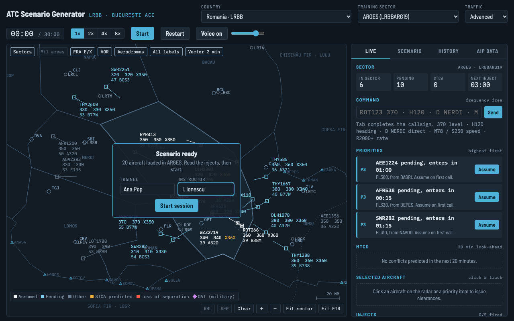

1. Choose **Country**, **Training sector** and **Traffic** (foundational 7, intermediate 13, advanced 20 aircraft) in the top bar.
2. On the **Scenario** tab, set the objective, session length (20, 30 or 45 min) and seed, then **Build scenario**. The same seed, sector and traffic level always give the same traffic.
3. Type the trainee and instructor names on the start overlay (optional; they go into the session record) and press **Start session**.
4. **Start** / **Freeze** stops and resumes the clock. **1× 2× 4× 8×** sets the speed. **Restart** runs the same scenario from 0.

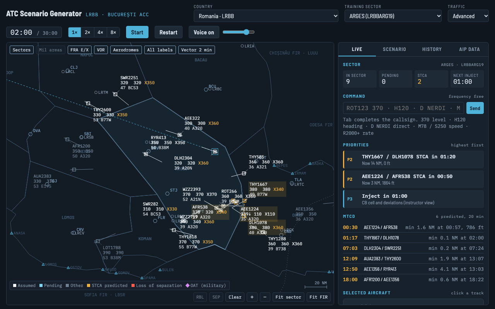

**Radar.**
- **Data block:** callsign; actual level, cleared level and agreed exit level (`X350`, amber when the cleared level differs from it); ground speed in tens of knots (`43` is 430 kt) and aircraft type.
- **Track colour:** white is assumed, blue is pending (transferred to you, to be assumed), grey is other traffic, magenta is military (OAT).
- **Data blocks:** drag one to move it.
- **Map:** zoom with the wheel or **+ −**, and return with **Fit sector** or **Fit FIR**. The chips at the top show or hide sectors, military areas, FRA points, VORs, aerodromes, all labels and the 2-minute vector.

**Live tab.**
- **Sector counts:** in sector, pending, STCA and next inject.
- **Command line:** see [Command line](#command-line).
- **Priorities:** highest first.
- **MTCD list.**
- **Selected aircraft:** click a track to open it.
- **Inject list** and **event log**.

**Selected aircraft.** It shows the flight's data, level, heading, direct, IAS, Mach and rate clearances, **Resume own navigation**, **Resume normal speed** and **Probe level**.

**Sector routine.**
- **Assume** pending traffic before it enters.
- **Clear** leaving traffic to its agreed exit level (XFL).
- **Transfer** it before it crosses the boundary.
- Only pending and assumed aircraft take clearances. Late assumes, late transfers and wrong exit levels are counted in the debrief.

**Radio.**
- Every clearance is one transmission. The pilot reads it back in the log 2-6 s later, in italics; the readback takes 4 s.
- The frequency is busy from the clearance to the end of the readback, shown as *frequency busy · CALLSIGN*. A clearance given then gets "say again" and is not applied.
- Assume and transfer are system actions, not radio calls.

## Two windows

One instructor, one trainee, in the same browser on the same computer. In solo mode, **Scenario → Open instructor and trainee windows**, or open the URLs yourself:

| URL | Role |
|---|---|
| `/` | solo: everything in one window |
| `/?role=instructor` | owns the session; adds the **Instructor** tab |
| `/?role=trainee` | what a controller would know; its clearances run in the instructor window |

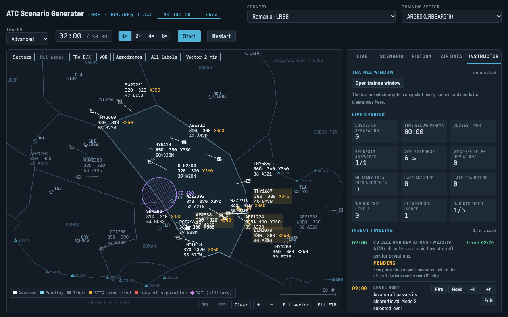

**Instructor tab.**
- **Link and grading:** link status and live grading.
- **Inject timeline:** **Fire**, **Hold**, **−1′ / +1′** and **Edit** while the session runs.
- **Pseudo-pilot** for the aircraft selected on the radar:
  - requests: level, weather deviation, direct;
  - refuse or "say again" the next clearance;
  - deviate 20° without clearance;
  - change squawk;
  - go silent for two minutes.

**Clock.** Start, Freeze and the speed buttons apply to both windows.

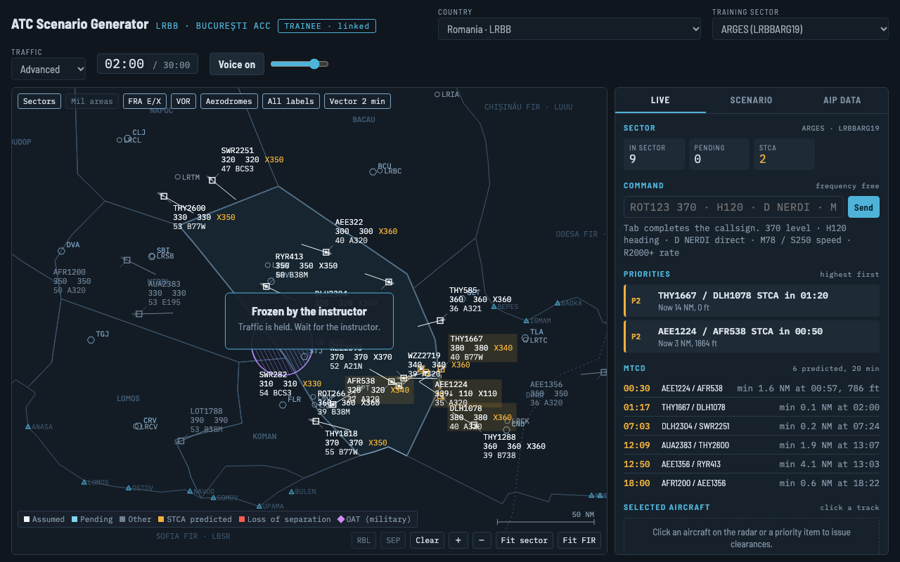

**Trainee window.** It shows the radar, priorities, selected aircraft, command line and log. It has no inject list, no inject warnings, no scenario title or challenges, and no clock controls. If the instructor window closes, it shows *Instructor window not responding* and keeps the last picture.

## Sectors

Romania has 10 elementary sectors and 5 collapsed configurations, from the EUROCONTROL NM sector file:
- **KOMAN** is published as two layers: KOMAN 1 below FL245 and KOMAN 2 from FL245 to FL660. The selector shows the band, e.g. "KOMAN 2 FL245-FL660".
- **Collapsed configurations** combine sectors or layers, e.g. KNL is KOMAN + LOMOS + NERDI.
- **Vertical limits:** an aircraft is in a layered sector only within its band. The lower limit is inclusive and the upper exclusive.

The **AIP data** tab lists the source of every file, the eAIP edition and the next AIRAC date.

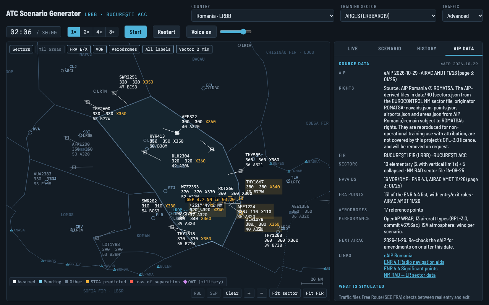

## Injects and grading

Injects fire at their minute and run in the simulation. Each has one measurable objective, graded live (instructor window) and in the debrief.

| Inject | Graded on |
|---|---|
| Level request | answered within 60 s |
| Level bust | level re-cleared within 60 s |
| CB cell and deviations | every deviation request answered before the aircraft deviates on its own (10 min) |
| Radio failure (7600) | no aircraft within 5 NM / 1000 ft of the 7600 track while it is silent |
| Emergency descent (7700) | acknowledged within 30 s, and no STCA with it in the descent to FL100 |
| Military area activation | none of your aircraft inside the active area within its vertical limits (10 min) |
| Unplanned traffic | no STCA involving it in its first 3 min |
| Exit level coordination | answered within 60 s, and the aircraft leaves at the agreed level |
| Late transfer from previous sector | assumed within 30 s of its first call |
| Readback error | wrong readback corrected before the aircraft acts on it (10 s after the readback) |
| Similar callsigns | clearance taken by the wrong aircraft corrected before it acts on it |
| COMLOSS and QRA scramble | military notified within 2 min of COMLOSS, QRA coordination answered within 60 s, traffic kept 5 NM / 2000 ft (1000 ft below FL290) from the QRA |
| OAT formation (non-RVSM) | coordination answered within 60 s, traffic kept 5 NM / 2000 ft from the formation |
| Short-notice military area extension | none of your aircraft inside the new limits (10 min) |

The civil-military injects are training constructs: which base holds QRA, the aircraft, callsigns and timings are invented. Military areas are the real ENR 5.2 areas; when one is active is the instructor's choice.

The **Scenario** tab has **Export** and **Import** for scenario files (JSON) and a library of sample scenarios. An imported file is checked first and every problem is listed.

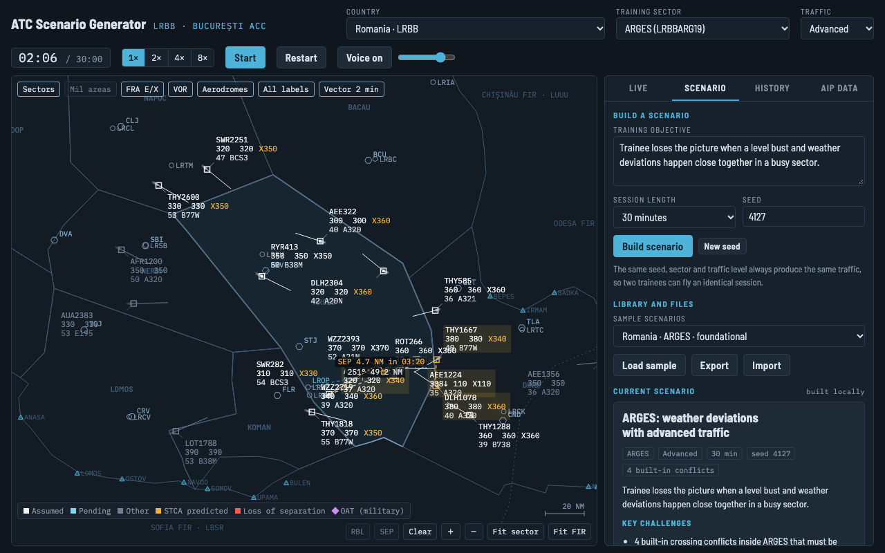

## Safety nets

| | What it alerts |
|---|---|
| **STCA** | predicted or actual loss of 5 NM / 1000 ft within 3 min: amber predicted, red loss |
| **APW** | your aircraft inside an active military area, or predicted to enter it within 2 min |
| **CLAM** | selected level differs from the cleared level (SFL), or more than 300 ft off it (DEV) |
| **RAM** | more than 3 NM off the cleared route leg while not on an ATC heading |
| **MTCD** | planned paths compared 20 min ahead; listed on the Live tab with time to loss and closest point, not alerted |

These are simplified training versions: there is no alert suppression and no per-area tuning.

## Tools

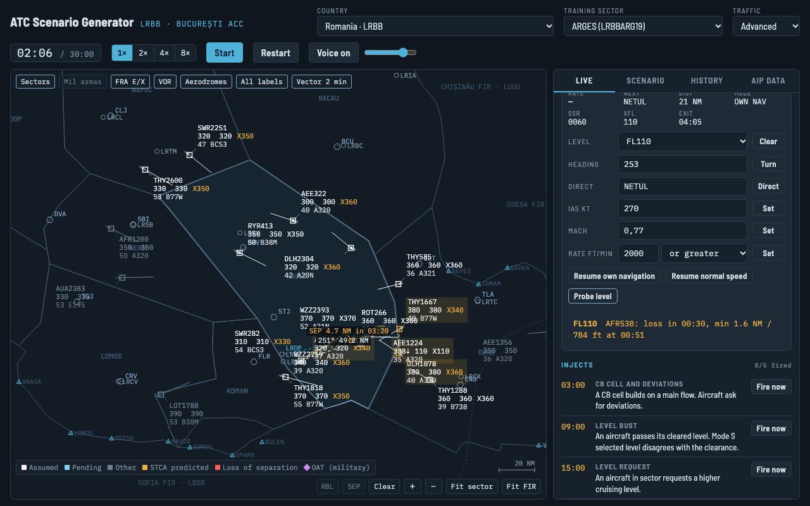

- **RBL:** click a point or a track, then another. It shows bearing (true) and range, and a track end follows the track.
- **SEP:** click two tracks. It shows the closest point if both keep present track and ground speed, amber below 5 NM.
- **Clear** removes all RBL and SEP lines.
- **Probe level** (selected aircraft): choose a level, press **Probe level**. It shows the conflicts and military areas that level would meet in the next 20 min. Nothing is cleared.

## Command line

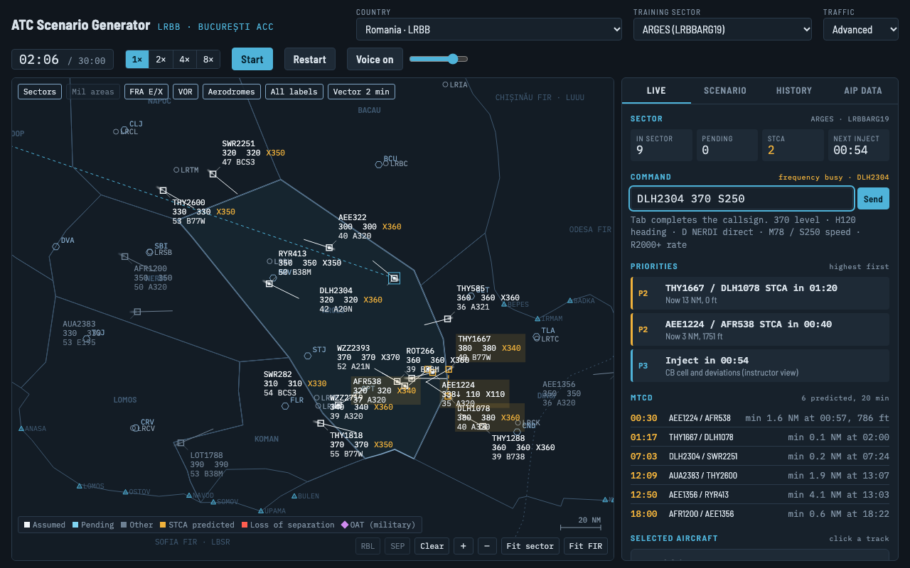

One transmission per line, sent with **Enter**:

| Type | Means |
|---|---|
| `ROT123 370` or `FL370` | climb or descend FL370 |
| `WZZ45 H120` | turn heading 120 |
| `THY1 D NERDI` (or `DNERDI`, `DCT NERDI`) | direct NERDI |
| `DLH3 M78` / `DLH3 S250` | Mach .78 / 250 kt IAS |
| `AFR12 R2000+` / `R1500-` | at 2000 ft/min or greater / 1500 or less |
| `ROT123 370 H120` | several items, read back together |

**Tab** completes the callsign; a partial callsign is never guessed. Errors show at once and nothing is sent. **Escape** clears the line.

## Pilot voices

Readbacks and requests are spoken in ICAO phraseology, with the operator's telephony designator ("WZZ1118" is "Wizz Air one one one eight").

- **Local voices only.** Only English voices installed on the computer are used; nothing is sent online. With none installed, nothing is spoken and the **Voice** button's tooltip says so. Add a voice in the system speech settings.
- **1× only.** Above 1× nothing is said. Transmissions whose slot passes at 2×, 4× or 8× are dropped, not said later. If you speed up while a pilot is talking, the transmission is finished, not cut. Freeze cuts it.
- **In the slot.** Each transmission is said in its radio slot (4 s), slightly faster if needed, and cut at the end; never late.
- **One voice per callsign:** each callsign keeps its voice, pitch and rate.
- **Controls:** **Voice on/off** and volume in the top bar, remembered in this browser. In two-window mode only the trainee window speaks.

Voice input is not supported.

## Session records

Every session that runs to its end is saved as a record, in the solo or instructor window:
- scenario and seed;
- names;
- per-inject results;
- timeline and statistics;
- the full clearance log;
- radar snapshots at each inject and loss of separation;
- instructor remarks typed in the debrief.

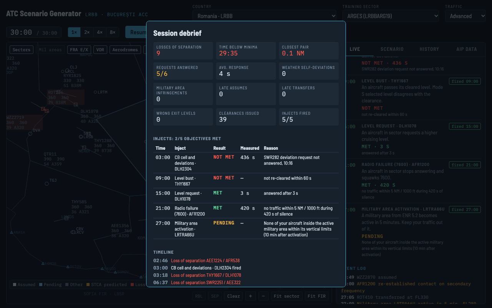

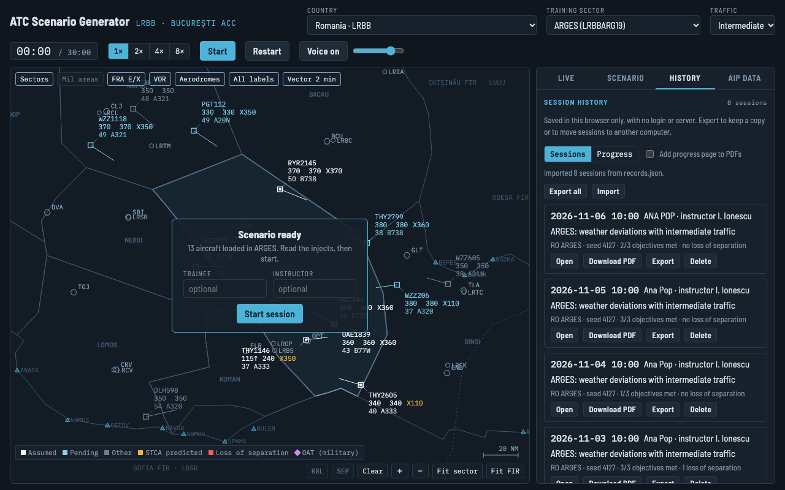

**History tab.**
- **Open:** the saved debrief. **Replay** reloads the same scenario and seed.
- **Download PDF.**
- **Export** one record, or **Export all**.
- **Import** either kind of file. Each record is checked; a record with the same id replaces the old one.
- **Delete** takes two clicks.

Records are kept in this browser only (IndexedDB). In a private window, or with site data blocked, they last until the page closes: export them.

## PDF debrief

**Download PDF** in the debrief or the History tab. It is made in the browser, offline. A4, named `<date>_<trainee>_<sector>.pdf`, and every page is marked **"Training aid, not an official assessment"**. It contains:
- header;
- objective and criteria;
- inject results with measured times and reasons;
- statistics and timeline;
- radar snapshots;
- remarks;
- signature lines.

The standard PDF fonts cover Western European letters only: Ș prints as S in the PDF (the app and the record keep it).

## Progress

**History → Progress**, then pick the trainee. Names match regardless of case and spacing.

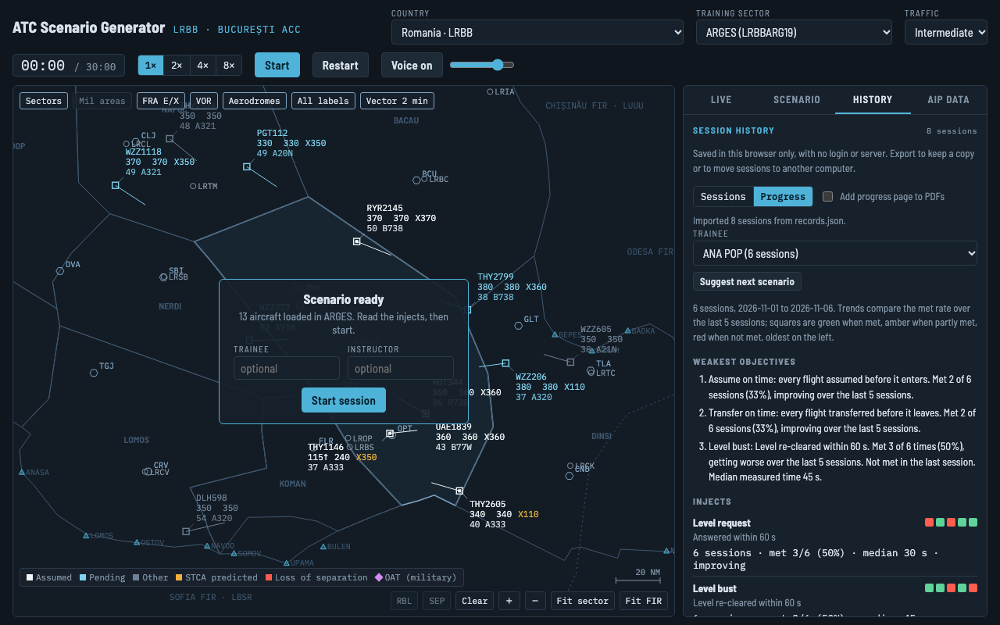

It shows:
- **Weakest objectives:** the three weakest, in plain words.
- **Per inject type:** sessions seen, met rate, median time, and the trend over the last 5 sessions (squares: green met, amber partly, red not met).
- **Every session:** no loss of separation, assume on time, transfer on time, exit levels.
- **Charts:** losses of separation, closest pair against 5 NM, late assumes, late transfers and wrong exit levels per session.

A trend needs 3 sessions, and an objective needs 2 sessions to be called weak.

**Add progress page to PDFs** appends the trainee's progress, as it stood at that session, to the PDF debrief.

## Scenario suggestions

**Progress → Suggest next scenario** proposes the next session from the trainee's records, with a reason for each choice:
- **Repeat:** the weakest objectives, up to three; their injects go in.
- **Traffic level:** up one after 3 sessions in a row at 80% or more of objectives met, and down one after 2 in a row under 50%.
- **Sector:** one not flown yet, or else the one flown longest ago.
- **Overlapping injects:** when prioritisation is weak, an emergency, a routine request and the weak inject come within 2 minutes.

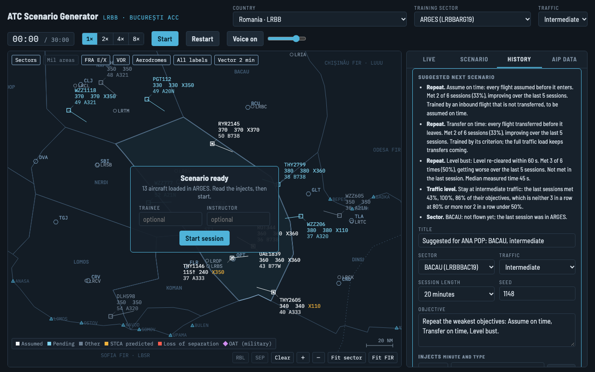

Everything is editable. **Accept and load** checks the result like an imported file and loads it; **Discard** loads nothing.

## AIRAC update

The eAIP changes every 28 days; the AIP data tab shows the next AIRAC date. From a clone of the repository, with network access to aisro.ro:

```bash
npm run airac                          # report what changed, write nothing
npm run airac -- --edition 2026-10-29  # a specific eAIP edition
npm run airac -- --write               # apply
npm test                               # then commit on a branch and open a PR
```

- **Updates** point coordinates and roles (ENR 4.4) and VOR/DMEs (ENR 4.1).
- **Rewrites** military areas from ENR 5.2.
- **Adds** new entry/exit points.
- **Reports** removed points and lost FRA roles. It never deletes a point the traffic still uses.
- **Sector polygons** are not touched: update them by hand from a new EUROCONTROL NM sector file.

## Data permissions

| Source | Files | Status |
|---|---|---|
| AIP Romania (ROMATSA) | navaids, points, military areas, aerodromes | kept, with attribution "Source: AIP Romania © ROMATSA"; permission requested |
| EUROCONTROL NM sector file (originator ROMATSA) | sectors | kept; covered by the same request |
| AIP Hungary (HungaroControl) | none | withdrawn: GEN 0.1 §5 requires prior written consent |
| FAA JO 7340.2P | telephony designators | US federal government work, source cited |
| OpenAP WRAP (TU Delft) | aircraft performance | GPL-3.0; the reason this project is GPL-3.0 |

The AIP-derived files remain subject to ROMATSA's rights. They are reproduced for non-operational training use, are not covered by this project's GPL-3.0 licence, and will be removed on request. Borders between published sector corners, traffic flows, exit levels and the civil-military injects are modelled, not published data. Details: [README, Data permissions](../README.md#data-permissions).
